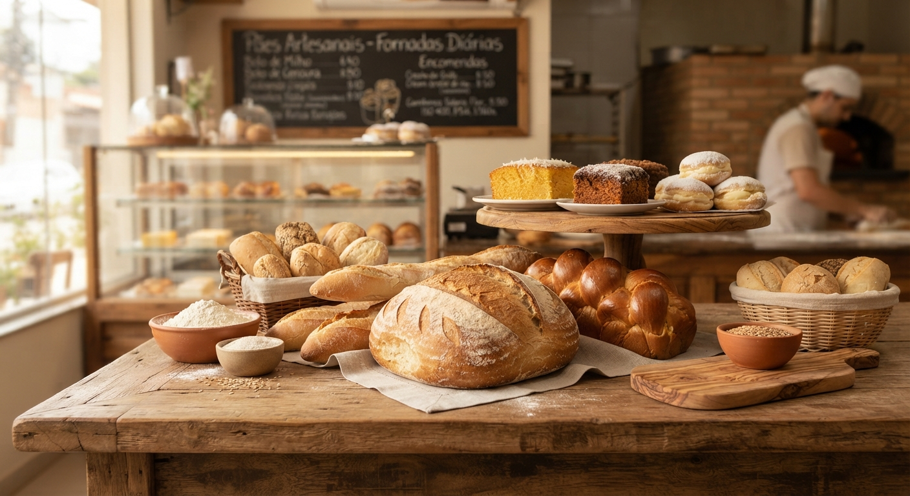

# Padaria Flor de Trigo — Projeto de Extensão (Web Standards)

Site institucional responsivo desenvolvido para a **Padaria Flor de Trigo** (Guarulhos/SP), alinhado aos Objetivos de Desenvolvimento Sustentável (ODS) da ONU para fortalecimento do comércio local.

# Tecnologias Utilizadas
* **Front-end:** HTML5, CSS3 e JavaScript
* **Back-end:** PHP (`salvar.php`).
* **Banco de Dados:** MySQL (`padaria_flor_de_trigo.sql`).

## Modelagem do Banco de Dados (DER)
